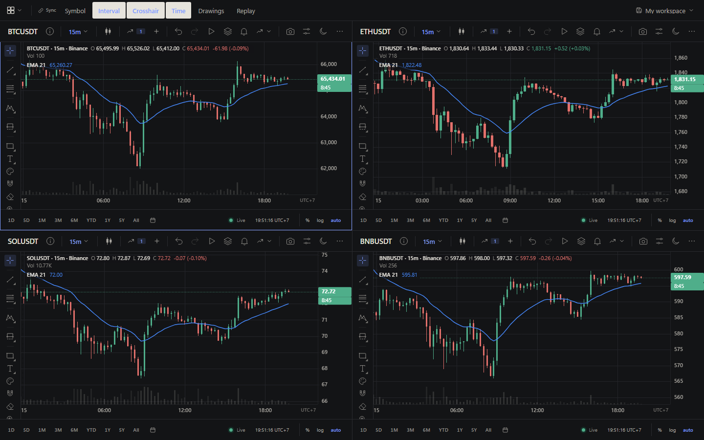

# TradeCanvas starter: multi-chart workspace

A 2x2 grid of live Binance charts built with [TradeCanvas](https://github.com/bonguynvan/tradecanvas)
(`@tradecanvas/chart`) and its `ChartWidgetGrid`: BTC, ETH, SOL and BNB against USDT, each a
full `ChartWidget`. The crosshair, the interval and scrolling are linked across the charts,
and the workspace is saved in the browser's localStorage, so it comes back as you left it.



## Run it

```bash
npm install
npm run dev
```

Then open the address Vite prints (http://localhost:5173). Other scripts:

| Script | What it does |
|---|---|
| `npm run build` | Type-checks, then builds the site into `dist/` |
| `npm run preview` | Serves `dist/` locally |
| `npm run typecheck` | Type-checks only |

Or try it without installing anything:
[Open in StackBlitz](https://stackblitz.com/github/bonguynvan/tradecanvas-starter-workspace)

## What is in it

- `src/main.ts` creates the grid: the arrangement (`'2x2'`), a Binance adapter per chart,
  each chart's symbol, the links between them, an EMA 21 on each chart, and the saved layout.
- The bar above the charts picks another arrangement (`1x2`, `1+3`, `3x3` and others) and
  turns each link on or off:
  - **Symbol**: a new pair on one chart goes to all (off here, or all four would show the same pair)
  - **Interval**: a new interval on one chart goes to all (on)
  - **Crosshair**: the time under the pointer shows on every chart (on)
  - **Time**: scrolling and zooming one chart moves the others (on)
  - **Drawings** and **Replay**: drawings copied between charts of the same pair, replays
    kept at the same time (off)
- On the first visit the workspace is saved as a named layout, "My workspace". After that
  every change (arrangement, links, pairs, intervals, indicators, drawings) is saved by
  itself and opened on the next visit. The layouts menu at the top right saves more named
  layouts. To start over, clear the site's storage in the browser.
- On a phone the grid shows one chart at a time, with a tab per chart.
- `.github/workflows/pages.yml` publishes the app on GitHub Pages on every push to `main`
  (turn it on once under Settings > Pages > Source: GitHub Actions).

## Use your own data

Each chart gets its own `BinanceAdapter` from the `adapter` function, because an adapter
keeps one live stream. To chart your own backend, replace it with your own adapter, or
remove `adapter` and give one `DataFeed` to every chart with `widget: { feed }`: a feed is
an object with `getBars` (history) and `subscribeBars` (live bars), and one feed serves any
number of charts. See [Real-time data](https://tradecanvas.dev/docs/realtime/) for the
`DataFeed` contract, `PollingAdapter` (REST) and `WebSocketAdapter`.

To keep the layouts on your server instead of in localStorage, pass
`layouts: { storage }` with an object that has `list`, `load`, `save` and `remove`.

## Where to go next

- [Getting started](https://tradecanvas.dev/docs/getting-started/): the widget, the bare
  `Chart`, and the React, Vue and Svelte components
- [TradeCanvas on GitHub](https://github.com/bonguynvan/tradecanvas): source, issues and
  the changelog

## License

MIT. See [LICENSE](LICENSE).
